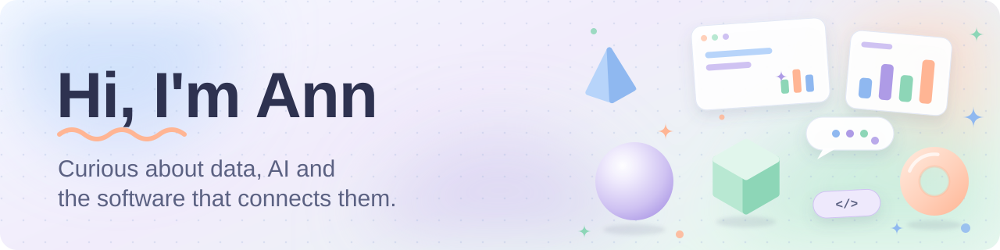
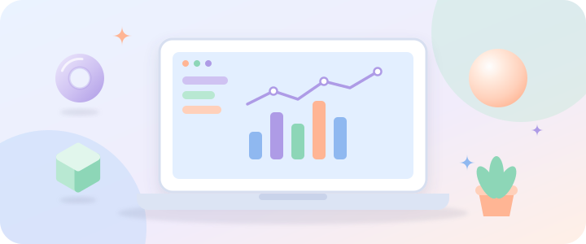
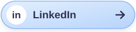

<!-- EDIT: INTRO (one friendly line) -->
👋 **Hello, I'm Ann Rai Jacob.** I'm a Computer Science engineer in Dubai who likes building things where **data, AI and software** meet.
<!-- /EDIT: INTRO -->

## About me

<!-- EDIT: ABOUT -->
I work in fintech and payments, where small details matter: a transaction that goes missing, an API that needs a sensible fallback, a dashboard number that someone has to trust. Day to day, that means coordinating integrations and reconciliation for a live payments platform.

Alongside work, I build data and machine-learning projects end to end, from model to API to dashboard. I enjoy turning business needs into things people can actually use.

- Based in Dubai, UAE
- Open to Data, Business or Product Analyst roles, and AI Applications / Solutions Engineer roles
- Happy to talk about data, AI, fintech and building useful things
<!-- /EDIT: ABOUT -->

## Education

<!-- EDIT: EDUCATION -->
**B.E. Computer Science Engineering** · BITS Pilani, Dubai Campus · *2021 – 2025*
Minor in Finance: Accounting, Financial Management, Security Analysis & Portfolio Management, Derivatives & Risk Management

**Learning and certifications**
Generative AI / LLM certification (DeepLearning.AI) · Generative AI for Software Development (IBM) · Job simulations: Data Science (BCG X) and GenAI-Powered Data Analytics (Tata)
<!-- /EDIT: EDUCATION -->

## Toolbox

<!-- EDIT: SKILLS
     Add a skill:  python tools/make_badge.py "Skill name" blue   (blue | lavender | mint | peach)
     then add a line like:  
     Remove a skill: delete its line. -->
**Data and machine learning**

**Analytics and reporting**

**APIs and infrastructure**

**Delivery and collaboration**

<!-- /EDIT: SKILLS -->

## Currently exploring

<!-- EDIT: EXPLORING (swap the text or icon; icons live in assets/icons) -->
| | |
|---|---|
|  | **AI and machine learning** — taking models beyond the notebook and into services people can use. |
|  | **LLMs** — working language models into data and software workflows. |
|  | **RAG** — grounding model answers in real documents, and checking that they stay grounded. |
|  | **Automation** — finding where scripts and workflows can take repetitive reporting and reconciliation work off people's plates. |
|  | **Engineering** — system design, APIs and monitoring: services that are dependable as well as clever. |
<!-- /EDIT: EXPLORING -->

## Connect with me

<!-- EDIT: CONNECT (same links as the top; replace the YOUR- placeholders) -->
Whether you're recruiting, collaborating or just curious about data and AI, I'd love to hear from you.

Prefer plain text? **Email:** annjacob.tech@gmail.com ·
<!-- /EDIT: CONNECT -->

*Made with curiosity*

